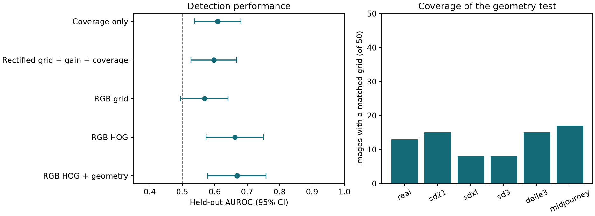

# Can depth-rectified grids detect generated indoor images?

**The synthetic control worked. The indoor-image pilot did not establish a reliable detection signal from plane–texture disagreement.** The geometry classifier achieved **0.598 AUROC**, and a classifier using only counts of accepted planes and grids achieved **0.609**. Adding geometry to the RGB baseline changed AUROC by **+0.007** (95% CI **−0.005 to +0.017**). The direct test was limited by coverage. Only 76 of 300 held-out images had a grid that could be scored both before and after rectification.

## Experiment

- **Data.** The supplied indoor MS COCOAI archive. I selected 100 caption-matched groups for training and 50 for held-out testing, each containing one photograph and one image from each of the five generators. That gave 600 training images and **300 held-out images, 50 per source**. I drew the pilot holdout from the archive's validation split to avoid the transformed copies in its original test split. I checked for overlapping caption IDs, normalized caption text, and identical image bytes across the selected splits.
- **Geometry.** UniDepth V2 ViT-S/14 estimated depth and pinhole intrinsics for all 900 images on a **Colab Tesla T4**. I fit planes to back-projected points in 13 overlapping windows per image, rectified accepted windows using the estimated normal, and scored grid spacing, line alignment, orthogonality, and crossings. I detected line segments independently in the two views and measured changes on matched windows.
- **Evaluation.** Class-balanced logistic regression used train-only imputation and scaling. The HOG baseline used histograms of oriented gradients from grayscale RGB input. All intervals use 2,000 bootstrap resamples of held-out caption groups and are conditional on the trained models. See the [protocol](PROTOCOL.md) for the fixed thresholds and definitions.

## Held-out detection

| Features | Pooled AUROC | 95% CI |
| --- | ---: | ---: |
| Coverage counts only | 0.609 | 0.538–0.681 |
| Rectified grid errors, gains, and coverage | 0.598 | 0.527–0.668 |
| Unrectified RGB grid | 0.569 | 0.494–0.642 |
| Unrectified RGB grid + geometry | 0.570 | 0.492–0.647 |
| RGB HOG | 0.662 | 0.574–0.750 |
| RGB HOG + geometry | 0.669 | 0.579–0.758 |

Pooled AUROC is the mean of the five generator-versus-real AUROCs, giving each generator equal weight. Adding geometry to the unrectified grid changed AUROC by +0.001 (95% CI −0.056 to +0.066). The stand-alone geometry classifier scored highest on DALL·E 3 and SDXL. Coverage alone scored slightly higher for both in the standard held-out evaluation.

| Generator | Geometry | Coverage only | RGB HOG | Geometry with this generator excluded from training |
| --- | ---: | ---: | ---: | ---: |
| Stable Diffusion 2.1 | 0.510 | 0.537 | 0.664 | 0.513 |
| SDXL | 0.667 | 0.673 | 0.630 | 0.667 |
| Stable Diffusion 3 | 0.542 | 0.519 | 0.663 | 0.524 |
| DALL·E 3 | 0.707 | 0.722 | 0.668 | 0.674 |
| Midjourney v6 | 0.563 | 0.594 | 0.687 | 0.535 |

## Direct test of the hypothesis

On a rendered grid with known camera and plane geometry, the composite error fell from **0.606** in the perspective view to **0.162** after correct rectification, a 73% reduction. Pairing the same rendering with the wrong plane normal raised the rectified error to **0.737**. Deliberately warping the grid on the correct plane gave **1.076**. Lower is more regular. These controls show that the implementation detects grid deformation and that plane-estimation error can produce a similar signal.

Only **13 of 50 real photos** and **63 of 250 generated images** supplied a grid score in both views. Each generator had only **3–6** captions where the real and generated image both scored. The table gives descriptive estimates for those pairs. Positive differences favor the hypothesis.

| Generator | Images scored (of 50) | Matched caption pairs | Residual, generated − real | Rectification gain, real − generated |
| --- | ---: | ---: | ---: | ---: |
| Stable Diffusion 2.1 | 15 | 3 | +0.156 | +0.308 |
| SDXL | 8 | 3 | −0.152 | −0.263 |
| Stable Diffusion 3 | 8 | 3 | +0.056 | +0.221 |
| DALL·E 3 | 15 | 6 | +0.086 | +0.000 |
| Midjourney v6 | 17 | 5 | +0.119 | +0.085 |

Residuals moved in the predicted direction for four generators, with the opposite result for SDXL. The small, selected set of matched pairs gives little leverage on the hypothesis, and some real photos had worse regularity after rectification. The main bottleneck was finding a grid on a usable depth plane. The RGB line heuristic accepted at least one candidate in every image. Without annotated surfaces, its candidates can include unrelated edges such as cabinets and door frames. The 256 × 256 resolution, rectangular-grid assumption, and errors in estimated normals or intrinsics all limit interpretation.

A follow-up that tests the physical claim would use a blind, pre-annotated set of visible tiled surfaces. Comparing estimated depth rectification with rectification from manually marked grid correspondences on those same surfaces would help distinguish weak geometry estimation from genuine texture deformation.

## Related work

Surface orientation from texture distortion and the rectification of repeated planar patterns are established problems. Sarkar et al. also use projective-geometry cues to detect generated images. This pilot tests a narrower combination: whether a monocular depth model and a repeated texture agree on the orientation of the same surface, and whether that agreement adds detection signal. A limited literature search leaves priority for that specific combination open. [Malik and Rosenholtz, 1997](https://people.eecs.berkeley.edu/~malik/papers/malik-rosen97.pdf) · [Pritts et al., CVPR 2014](https://openaccess.thecvf.com/content_cvpr_2014/html/Pritts_Detection_Rectification_and_2014_CVPR_paper.html) · [Sarkar et al., CVPR 2024](https://openaccess.thecvf.com/content/CVPR2024/html/Sarkar_Shadows_Dont_Lie_and_Lines_Cant_Bend_Generative_Models_dont_CVPR_2024_paper.html)

[Reproduction instructions](README.md) · [Full metrics](results/metrics.json) · [Per-image scores](results/scores.csv)
